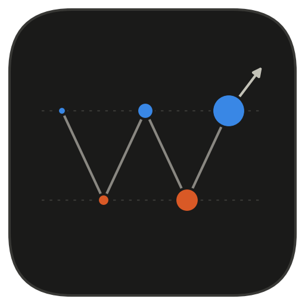
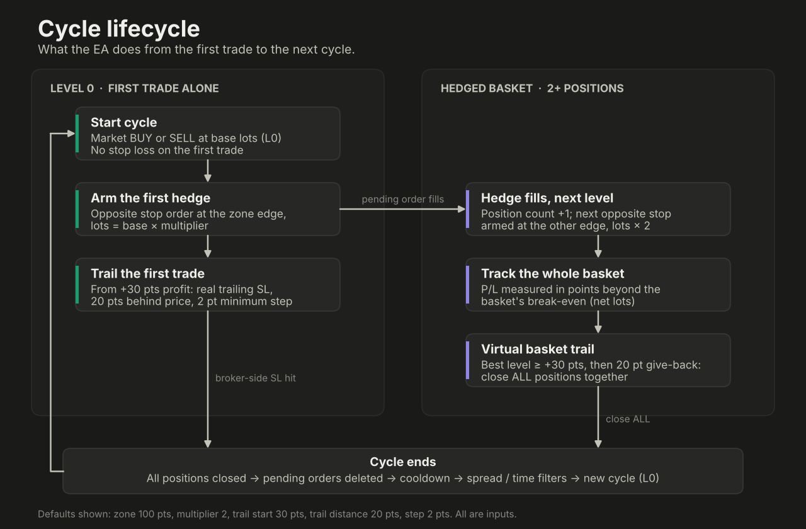
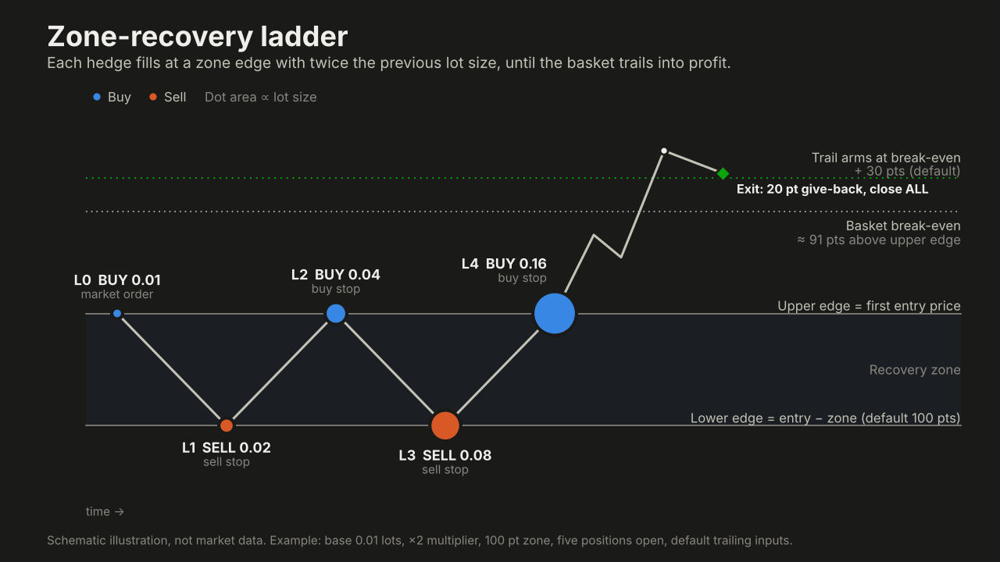
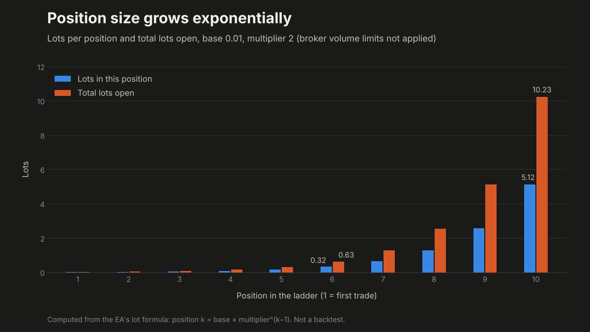

<p align="center">
  
</p>

<h1 align="center">Hedge Ladder EA</h1>

<p align="center">
  A zone-recovery expert advisor for MetaTrader 5. It answers an adverse move with a ladder of doubling,
  opposite-side orders, then closes the whole basket on a trailing profit.
</p>

<p align="center">
  
  
  
  
  
</p>

> [!CAUTION]
> This is a martingale-style recovery system. Position size doubles with every hedge, and v1.00 has **no cap on
> ladder depth, no margin check and no equity stop**. A long one-directional move can lose the entire account.
> No profit is guaranteed. Test on a demo account first and read the [risk disclaimer](../../RISK_DISCLAIMER.md).

## Overview

Hedge Ladder EA opens a market order with **no stop loss**. Instead, it arms an opposite stop order a fixed
distance away (the *zone*). If price reaches that edge, the order fills with twice the lots. If price then returns
through the original entry, another order fills with twice *that*. The ladder keeps alternating between the two
edges until the basket as a whole is in profit by a trailing threshold, at which point every position is closed
together and a new cycle starts.

If the first trade is never hedged, it is managed with an ordinary trailing stop loss.

| | |
|---|---|
| **Platform** | MetaTrader 5 (MQL5 expert advisor) |
| **Account type** | **Hedging only** (the EA refuses to start on a netting account) |
| **Entry signal** | None. A new cycle opens as soon as the gates below allow it |
| **Exit** | Real trailing SL on a lone first trade; virtual trailing on a hedged basket |
| **Source** | [`Hedge_Ladder_EA.mq5`](Hedge_Ladder_EA.mq5) |

## How it works

<p align="center">
  
</p>

1. **Gates.** A new cycle starts only if terminal AutoTrading and the EA's *Allow Algo Trading* are on, the
   optional time window and spread limit allow it, and the cooldown since the last cycle has elapsed.
2. **Level 0.** A market BUY or SELL (per `InpDirectionMode`) for `InpBaseLots`, with no stop loss.
3. **The zone.** For a BUY start the upper edge is the entry price and the lower edge is `entry − D`. A SELL start
   mirrors this. `D = max(InpZonePoints, stops level + spread + 5)` points.
4. **Hedging.** After every fill the EA arms exactly one pending order for the next level: an odd position count
   hedges *against* the first trade at the far edge, an even count re-enters *with* it at the entry edge. Lots are
   `InpBaseLots × InpLotMultiplier^n`. If price is already at or through the edge, a market order is used instead.
5. **Exit, first trade alone.** Once profit reaches `InpTrailStartPoints`, a real trailing stop follows price at
   `InpTrailDistancePoints`, moving only when it improves by at least `InpTrailStepPoints`.
6. **Exit, hedged basket.** A single stop price cannot cover buys and sells, so the EA trails the basket's profit
   *virtually*: it measures the basket's distance beyond break-even, remembers the best value, and closes **all**
   positions once that best value is at least `InpTrailStartPoints` and price has given back
   `InpTrailDistancePoints`.
7. **Cleanup.** When no positions remain, leftover pending orders are deleted, the cooldown runs, and a new cycle
   begins.

<p align="center">
  
</p>

A line-by-line walkthrough with the break-even maths is in [`docs/strategy.md`](docs/strategy.md).

## What the risk looks like

<p align="center">
  
</p>

The table below is computed from the EA's own lot formula, with the defaults (base 0.01, multiplier 2, zone 100
points). Money figures assume about $1 per point per lot, which is typical for a 5-digit USD forex major such as
EURUSD. Other symbols differ, so recompute from your symbol's specification. Spread, slippage, swap and commission
are ignored.

| Position | Lots | Total lots open | Basket floating loss when it opens | Distance past that edge to basket break-even |
|---:|---:|---:|---:|---:|
| 1 | 0.01 | 0.01 | n/a | n/a |
| 2 | 0.02 | 0.03 | $1 | 100 pts |
| 3 | 0.04 | 0.07 | $2 | 67 pts |
| 4 | 0.08 | 0.15 | $5 | 100 pts |
| 5 | 0.16 | 0.31 | $10 | 91 pts |
| 6 | 0.32 | 0.63 | $21 | 100 pts |
| 7 | 0.64 | 1.27 | $42 | 98 pts |
| 8 | 1.28 | 2.55 | $85 | 100 pts |
| 9 | 2.56 | 5.11 | $170 | 99 pts |
| 10 | 5.12 | 10.23 | $341 | 100 pts |

Two things stand out. The floating loss roughly doubles with each level, and price has to travel about **one full
zone beyond the edge** before the basket is back to break-even. The virtual trail then arms a further 30 points
(default) beyond that. A sideways market can build the ladder deep, and a strong one-way move after that leaves a
large position with no further hedges.

## Requirements

- MetaTrader 5 with a **hedging** account (check *Account type* in your broker's account details).
- A symbol whose point size you understand. `InpZonePoints` and all trailing inputs are in **points**, so 100 points
  is 10 pips on a 5-digit pair but a very different distance on gold or indices.
- A terminal that stays online. The basket exit is virtual and runs inside the terminal, not at the broker.

## Install

Short version: copy `Hedge_Ladder_EA.mq5` to `MQL5/Experts`, compile it in MetaEditor (F7), drag it onto a chart,
tick *Allow Algo Trading*, and make sure the AutoTrading button is green. Step-by-step instructions and
troubleshooting are in [`docs/installation.md`](docs/installation.md).

## Inputs

The defaults below come straight from the source. The full reference, with the exact effect of each input, is in
[`docs/parameters.md`](docs/parameters.md).

| Input | Default | Meaning |
|---|---|---|
| `InpDirectionMode` | `DIR_BUY` | First trade direction: Buy, Sell, or alternate each cycle |
| `InpBaseLots` | `0.01` | Lots of the first trade |
| `InpLotMultiplier` | `2.0` | Each hedge is the previous lot size times this |
| `InpZonePoints` | `100` | Distance from first entry to the hedge price, in points |
| `InpTrailStartPoints` | `30` | Profit (points) before trailing begins |
| `InpTrailDistancePoints` | `20` | How far behind the best price the trail sits |
| `InpTrailStepPoints` | `2` | Minimum SL improvement, first trade only |
| `InpMaxSpreadPoints` | `0` (off) | Do not start a cycle if spread is above this |
| `InpUseTimeFilter` | `false` | Only start new cycles inside the hour window |
| `InpMagic` | `20261018` | Magic number identifying this EA's orders |

## On-chart status messages

The EA writes its state to the chart comment and the *Experts* tab.

| Message | Meaning |
|---|---|
| `BLOCKED: click the AutoTrading button...` | Terminal-level AutoTrading is off |
| `BLOCKED: tick 'Allow Algo Trading'...` | The EA's own trading permission is off |
| `WAITING: outside time window` / `spread too high` | A start gate is closed |
| `CYCLE STARTED: first trade open` | Level 0 was opened |
| `LEVEL n: BUY/SELL x lots armed at ...` | The next hedge is armed |
| `ORDER REJECTED` / `HEDGE REJECTED` | The broker refused an order; the EA retries |
| `BASKET TRAIL HIT: closing all` | The virtual basket trail fired |

## Known limitations (v1.00)

These describe what the current source does, so you can decide whether it fits your risk tolerance.

- **No ladder depth limit.** Lots are bounded only by the broker's own maximum volume. If a level hits that
  maximum, doubling stops and the basket no longer recovers as designed.
- **No margin check, lot cap or equity stop.** Nothing in the EA halts trading when margin runs short or equity
  falls.
- **No entry signal.** A cycle opens whenever the gates allow, and a new one starts right after each exit, so the
  EA is effectively always in the market.
- **Basket exit is virtual.** If the terminal or connection goes down mid-ladder, there is no broker-side stop
  covering the basket.
- **Basket P/L excludes commission.** The exit logic sees position profit plus swap only.
- **One basket per symbol and magic number.** Use a different `InpMagic` for each chart you run.
- **`g_paused` is never set.** The pause flag exists in the code but nothing turns it on.

## Backtesting

No backtest results are published for this EA yet. When you add some, put the screenshots in
[`images/backtests/`](images/backtests/) and record the symbol, period, modelling mode, broker, date range and every
input, so others can reproduce them.

## Folder contents

```
hedge-ladder-ea/
├── Hedge_Ladder_EA.mq5      EA source
├── README.md                this file
├── docs/
│   ├── strategy.md          logic walkthrough and break-even maths
│   ├── parameters.md        every input explained
│   └── installation.md      install, run, troubleshoot
└── images/                  diagrams, logo, backtest screenshots
```

## License

[MIT](../../LICENSE). Provided as-is, with no warranty and no guarantee of profit.
